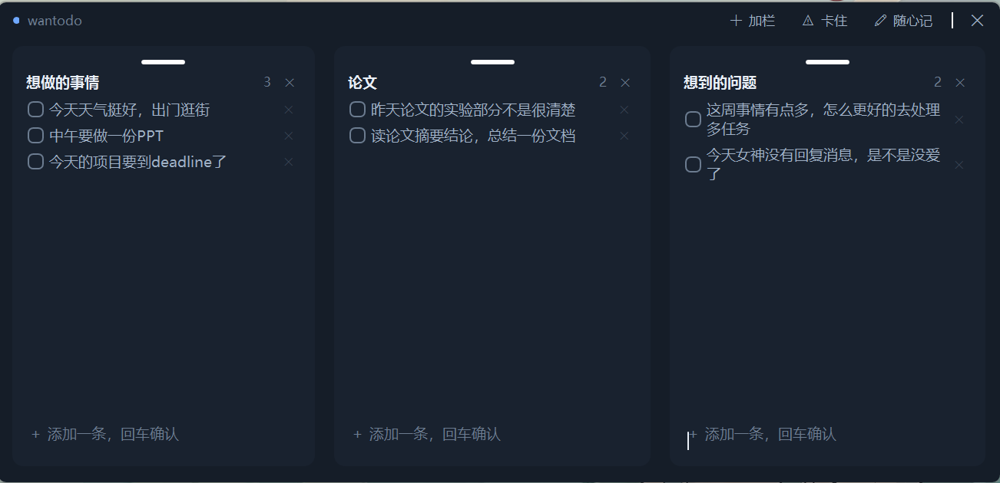
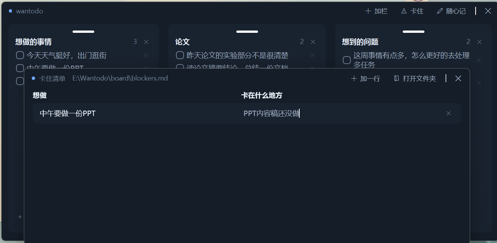
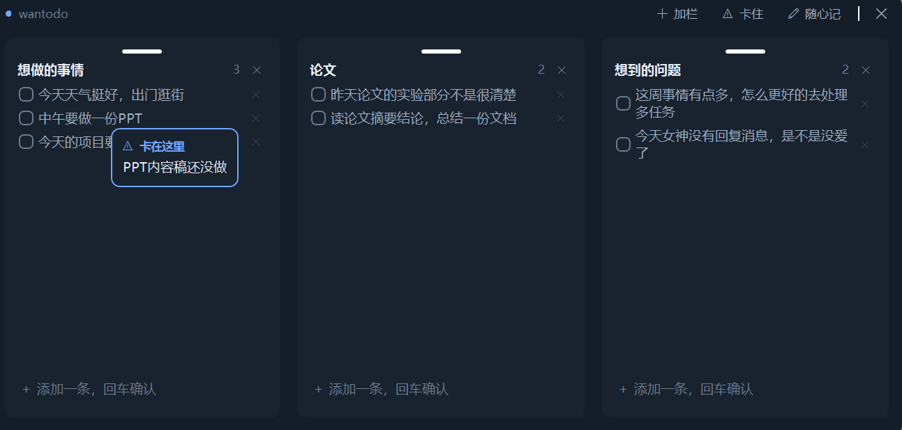
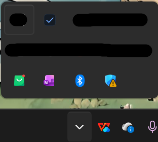
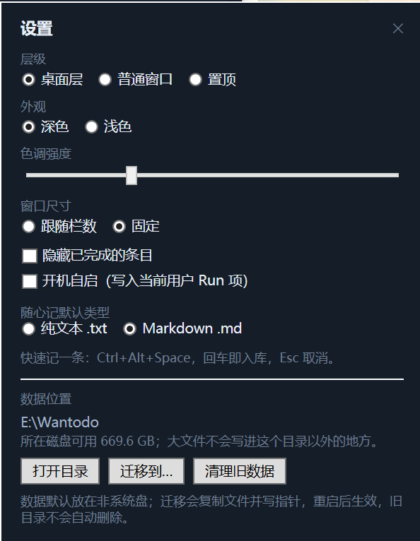

# wantodo

贴在 Windows 桌面上的便签板——像手机主屏的小组件，但里面是你的待办、随手记和"卡在什么地方"。



它能贴在桌面图标那一层：**Win + D 之后还在**，普通窗口可以盖住它，不抢焦点，也不会挡在浏览器前面。

---

## 下载

**[下载最新版](https://github.com/yyunx/wantodo/releases/latest)** — Windows 10 1809+ / 11 x64，两个包任选其一：

| 包 | 大小 | 需要装 .NET 吗 | 适合 |
| --- | --- | --- | --- |
| `wantodo-0.5.0-win-x64.zip` | 60.9 MB | 不需要 | 直接发给别人，解压双击即用 |
| `wantodo-0.5.0-fdd-win-x64.zip` | 0.2 MB | 需要 [.NET 10 Desktop Runtime](https://dotnet.microsoft.com/download/dotnet/10.0) | 自己机器已经装了运行时，想省空间 |

用法：解压 → 双击 `Wantodo.exe`。第一次运行如果被 SmartScreen 拦下（exe 没有代码签名），点「更多信息 → 仍要运行」。

想要开始菜单快捷方式，把 `install.ps1` 和 `Wantodo.exe` 放一起，执行：

```powershell
powershell -ExecutionPolicy Bypass -File .\install.ps1
```

它只装到 `%LOCALAPPDATA%\Programs\wantodo`，不需要管理员，也不碰系统目录。

---

## 功能

**多栏待办板**

- 栏数 1–4，加栏时会问你要叫什么名字（直接回车用默认名）
- 栏可以**拖到任意位置**停靠：顶部拖动条按住，拖到别的栏左/右/上/下，松手就按预览的位置并排
- 拖到正中就是两栏互换；分隔条单独拖动调比例，**窗口大小不变**
- 窗口宽度跟随栏数自动伸缩（2 栏 592 / 3 栏 880 / 4 栏 1168），手动拖过窗口后自动切成"固定"，不再自动改

**条目**

- 回车加一条；双击就地改；勾选划线置灰；`Shift + Enter` 换行
- 拖拽排序（有插入位置提示）；`↑ ↓` 移动、`Space` 勾选、`Enter` 编辑
- 删掉条目有二次确认

**随心记**（顶栏「随心记」入口 / 托盘 / `Ctrl + Alt + Space`）

- 就是一个文件夹里的 `.txt` 或 `.md`，**不是数据库**，Obsidian、VSCode 都能直接开
- 外部编辑器改了文件，窗口 2 秒内自动刷新；改名保留时间前缀
- 删除进 `trash\`，保留 30 天

**卡住清单**（顶栏「⚠ 卡住」）

- 左边"想做的事"、右边"卡在什么地方"，存成 `board\blockers.md` 的 Markdown 表格
- 从主界面把条目**拖到「卡住」按钮**上，就自动加一行
- 主界面上有卡住原因的条目，鼠标悬停会显示深色提示卡片

**其它**

- 托盘：左键显示/隐藏（不抢焦点），右键菜单有层级、外观、开机自启、退出
- 外观：深色 / 浅色 + 色调强度
- 全局快捷键 `Ctrl + Alt + Space`：不切窗口直接记一条
- 单实例：重复打开只把已有窗口叫到前面
- 数据不在 C 盘：自动选非系统盘，可在「设置 → 数据位置」整体迁移

---

## 截图

**工具栏**（加栏 / 卡住 / 随心记）



**卡住清单**



**主界面悬停看卡住原因**



**托盘菜单**



---

## 三个容易踩的点


1. **右上角 ✕ 是隐藏到托盘**，不是退出。要真的退出：托盘右键 →「退出」。
2. **数据不在 exe 旁边**。默认放非系统盘（程序在非 C 盘时用 `<程序目录>\data`；在 C 盘时用剩余空间最大的非系统盘建 `<盘>:\Wantodo`）。按「设置 → 数据位置」能看到当前根，也能一键迁移。
3. **首次运行会被 SmartScreen / 杀软提醒**，因为没有代码签名。介意的话自己从源码构建。

---

## 快捷键

| 位置 | 按键 | 作用 |
| --- | --- | --- |
| 全局 | `Ctrl + Alt + Space` | 唤出"记一条"，回车入库 |
| 栏尾输入框 | `Enter` | 提交并继续下一条 |
| 条目列表 | `↑` `↓` | 移动选中行 |
| 条目列表 | `Space` | 勾选 / 取消 |
| 条目列表 | `Enter` | 就地编辑 |
| 就地编辑 | `Enter` | 提交 |
| 就地编辑 | `Shift + Enter` | 换行 |
| 就地编辑 | `Esc` | 取消 |
| 栏标题 | 双击 | 改名 |
| 栏顶部横条 | 按住拖动 | 停靠到别的位置 |

---

## 数据在哪

```
<数据根>\
  board\data.json      待办板（原子写 + data.bak 回退 + 损坏隔离）
  board\blockers.md    卡住清单（Markdown 表格，可直接编辑）
  notes\inbox\*.md|txt 随心记（文件名即标题，md 带 front matter）
  logs\app-yyyyMMdd.log
  trash\               删除的笔记，保留 30 天
  README.txt           这个目录是干什么的
```

整个数据根目录拷走就是完整备份；换机器拷回去即可继续用。

---

## 从源码构建

需要 .NET 10 SDK（.NET 8 / 9 已于 2026-11-10 结束支持）。

```powershell
git clone https://github.com/yyunx/wantodo.git
cd wantodo

dotnet build Wantodo.slnx -warnaserror
dotnet test  Wantodo.slnx

# 发布单文件（自包含，约 149 MB）
dotnet publish src\Wantodo.App\Wantodo.App.csproj -c Release -r win-x64 `
  --self-contained true -p:PublishSingleFile=true `
  -p:IncludeNativeLibrariesForSelfExtract=true -o publish\sc
```

开发时直接跑 `src\Wantodo.App\bin\Debug\net10.0-windows\Wantodo.exe` 即可。如果 .NET SDK 装在用户目录，先设：

```powershell
$env:DOTNET_ROOT="$env:LOCALAPPDATA\Microsoft\dotnet"; $env:PATH="$env:DOTNET_ROOT;$env:PATH"
```

### 项目结构

```
src/Wantodo.Core/          模型、布局树、持久化、笔记库、卡住清单（纯逻辑，可单测）
src/Wantodo.App/           WPF 宿主：窗口、ViewModel、Interop(桌面层)、托盘、对话框
tests/Wantodo.Core.Tests/  159 个单元测试
docs/                      规格、计划、决策、设计、验收记录、使用说明
spike/                     早期验证桌面层行为的一次性探针
```

技术栈：WPF + .NET 10。桌面层是通过 `SetWindowLongPtr(GWLP_HWNDPARENT, Progman)` 把窗口挂成桌面窗口的 **owner**（不是 `SetParent`），所以 Win+D 不隐藏、普通窗口能盖住。细节见 `docs/decisions.md`。

---

## 文档

| 文档 | 内容 |
| --- | --- |
| [docs/usage.md](docs/usage.md) | 使用说明（安装、日常操作、备份、FAQ） |
| [docs/spec.md](docs/spec.md) | 产品规格与数据模型 |
| [docs/plan.md](docs/plan.md) | 分阶段计划与验收记录 |
| [docs/decisions.md](docs/decisions.md) | 技术决策与取舍（D1–D17） |
| [docs/design/](docs/design/) | 数据根、停靠布局设计 |
| [docs/verify/](docs/verify/) | 每个阶段的实测证据与截图 |

---

## 许可

暂未添加 LICENSE 文件（默认保留所有权利）。如需开源请补一个（MIT / Apache-2.0 都可以）。
