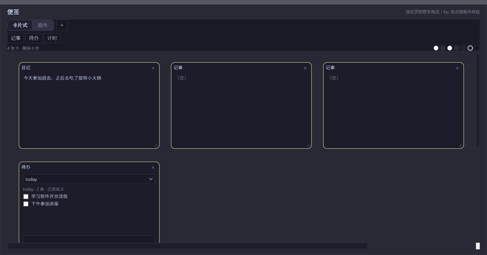
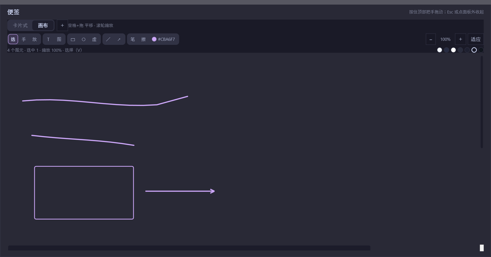
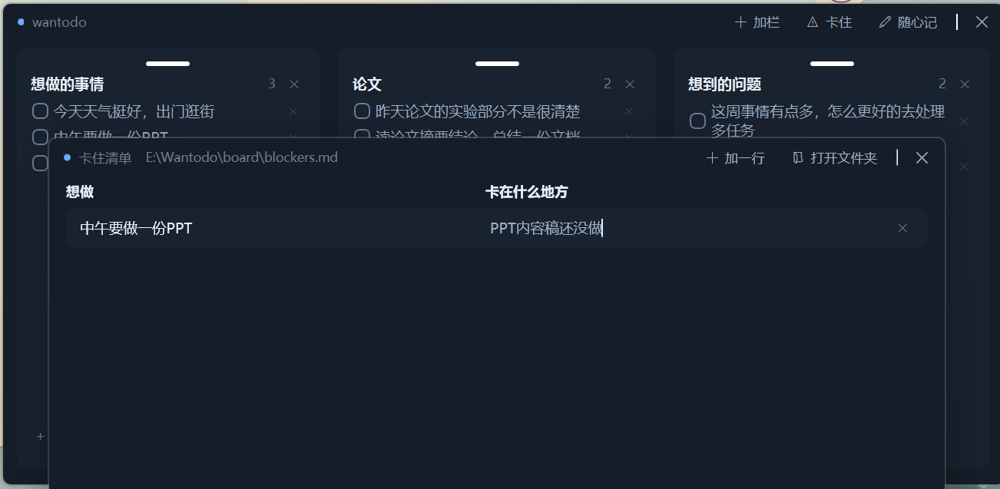
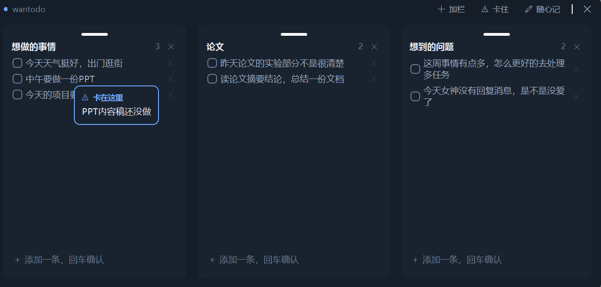
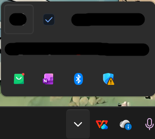
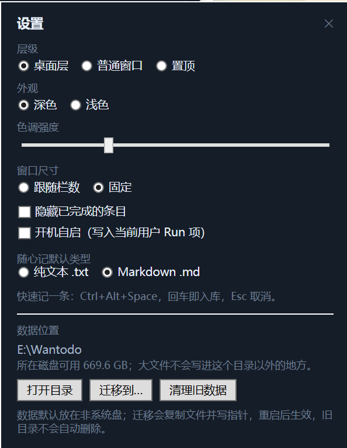

# wantodo

贴在 Windows 桌面上的便签板——像手机主屏的小组件，但里面是你的待办、随手记和"卡在什么地方"。



它能贴在桌面图标那一层：**Win + D 之后还在**，普通窗口可以盖住它，不抢焦点，也不会挡在浏览器前面。

---

## 下载

**[下载最新版](https://github.com/yyunx/wantodo/releases/latest)** — Windows 10 1809+ / 11 x64，两个包任选其一：

| 包 | 大小 | 需要装 .NET 吗 | 适合 |
| --- | --- | --- | --- |
| `wantodo-0.6.0-win-x64.zip` | 61.0 MB | 不需要 | 直接发给别人，解压双击即用 |
| `wantodo-0.6.0-fdd-win-x64.zip` | 0.3 MB | 需要 [.NET 10 Desktop Runtime](https://dotnet.microsoft.com/download/dotnet/10.0) | 自己机器已经装了运行时，想省空间 |

用法：解压 → 双击 `Wantodo.exe`。第一次运行如果被 SmartScreen 拦下（exe 没有代码签名），点「更多信息 → 仍要运行」。

想要开始菜单快捷方式，把 `install.ps1` 和 `Wantodo.exe` 放一起，执行：

```powershell
powershell -ExecutionPolicy Bypass -File .\install.ps1
```

它只装到 `%LOCALAPPDATA%\Programs\wantodo`，不需要管理员，也不碰系统目录。

---

## 功能

**两个表面：卡片式 / 画布**

顶栏第一行左侧是分段控件：**卡片式**（可以拖来拖去的便签卡，每张卡是记事 / 待办 / 计时 / 图片）和**画布**（随手画、贴图、摆位置）。共用一份数据、一个窗口、一套主题，切换只是换视图；两个表面各有自己的撤销栈（各 50 步）。

- 卡片式：4 种卡（记事 / 待办 / 计时 / 图片），栏目下拉、卡头拖动、双击改名
- 画布：十个工具（选择/手形/文本/图片/矩形/线/箭头/画笔/橡皮/缩放），缩放 25%–400%，`空格 + 拖` 平移，右键菜单有粘贴/全选/删除
- 工具栏上的**色块直接显示当前画笔颜色**（`#CBA6F7` 这样），点开可选 8 种颜色与 4 档粗细，换色马上反映在色块上
- 切到笔 / 橡皮 / 放大镜时**鼠标形状跟着变**（画笔、橡皮、放大镜），不用猜现在是哪个工具
- 画笔颜色认准「你挑的那个色」：换主题、换背景都不会把已经选好的笔色悄悄改掉（想跟随色板就选「跟随色板强调色」）
- 橡皮有 12 DIP 的容差，不用像素级对准也能擦掉；按住不放可以连续擦

**主题：材质 × 色板**

- 材质（本期只有「液态玻璃」）决定圆角与透明度，色板决定颜色，两者正交
- 7 套色板：Tokyo Night Day / Tokyo Night / Latte / Frappé / Macchiato / Mocha / Neon；状态行右端有 7 个色点，**色点显示的就是那套色板的背景色**，点一下换色
- 换色是**立刻生效**的：卡片、画布上的图形、色点都会即时跟着换（不用像以前那样"动一下才刷新"）
- 液态玻璃：Win11 22621+ 用 Mica（面板与设置页能看到桌面透出来），老系统自动退纯色并写日志，不会假装有玻璃

**多栏待办板**

- 栏数 1–4，加栏时会问你要叫什么名字（直接回车用默认名）
- 栏可以**拖到任意位置**停靠：顶部拖动条按住，拖到别的栏左/右/上/下，松手就按预览的位置并排
- 拖到正中就是两栏互换；分隔条单独拖动调比例，**窗口大小不变**
- 窗口宽度跟随栏数自动伸缩（2 栏 592 / 3 栏 880 / 4 栏 1168），手动拖过窗口后自动切成"固定"，不再自动改

**条目**

- 回车加一条；双击就地改；勾选划线置灰；`Shift + Enter` 换行
- 拖拽排序（有插入位置提示）；`↑ ↓` 移动、`Space` 勾选、`Enter` 编辑
- 删掉条目有二次确认

**画布卡片**

- 画板上可以放记事卡、待办卡、计时卡、图片卡，拖动改位置、拖右下角改大小
- 卡头按住移动超过 4 DIP 才拖动；改名只走**双击标题**或 `F2`（0.6.0 里“想拖却改名”的老问题已修）
- 待办卡是**栏目投影**：桌面上加一条，1 秒内出现在卡里；卡里勾选，桌面同步划线；卡里回车也能加
- 计时卡：未开始 → 已设置 → 进行中 ⇄ 已暂停 → 已结束；设置完不会自动跑；番茄钟可分段（最多 4 段，自定义每段的重复数/专注/休息）
- 图片卡无外框，双击打开；画布上还可以直接画笔迹、矩形、线、箭头、文本

**随心记**（顶栏「随心记」入口 / 托盘 / `Ctrl + Alt + Space`）

- 就是一个文件夹里的 `.txt` 或 `.md`，**不是数据库**，Obsidian、VSCode 都能直接开
- 外部编辑器改了文件，窗口 2 秒内自动刷新；改名保留时间前缀
- 删除进 `trash\`，保留 30 天

**卡住清单**（顶栏「⚠ 卡住」）

- 左边"想做的事"、右边"卡在什么地方"，存成 `board\blockers.md` 的 Markdown 表格
- 从主界面把条目**拖到「卡住」按钮**上，就自动加一行
- 主界面上有卡住原因的条目，鼠标悬停会显示深色提示卡片

**其它**

- 托盘：左键显示/隐藏（不抢焦点），右键菜单有层级、外观、开机自启、退出
- 外观：深色 / 浅色 + 色调强度
- 全局快捷键 `Ctrl + Alt + Space`：不切窗口直接记一条
- 单实例：重复打开只把已有窗口叫到前面
- 数据不在 C 盘：自动选非系统盘，可在「设置 → 数据位置」整体迁移

---

## 截图

**卡片式**——四张卡、栏目下拉、右上角色板


**画布**——十个工具、当前画笔色、缩放与适应



**工具栏**（加栏 / 卡住 / 随心记）



**卡住清单**



**主界面悬停看卡住原因**



**托盘菜单**



---

## 三个容易踩的点


1. **右上角 ✕ 是隐藏到托盘**，不是退出。要真的退出：托盘右键 →「退出」。
2. **数据不在 exe 旁边**。默认放非系统盘（程序在非 C 盘时用 `<程序目录>\data`；在 C 盘时用剩余空间最大的非系统盘建 `<盘>:\Wantodo`）。按「设置 → 数据位置」能看到当前根，也能一键迁移。
3. **首次运行会被 SmartScreen / 杀软提醒**，因为没有代码签名。介意的话自己从源码构建。

---

## 快捷键

| 位置 | 按键 | 作用 |
| --- | --- | --- |
| 全局 | `Ctrl + Alt + Space` | 唤出"记一条"，回车入库 |
| 栏尾输入框 | `Enter` | 提交并继续下一条 |
| 条目列表 | `↑` `↓` | 移动选中行 |
| 条目列表 | `Space` | 勾选 / 取消 |
| 条目列表 | `Enter` | 就地编辑 |
| 就地编辑 | `Enter` | 提交 |
| 就地编辑 | `Shift + Enter` | 换行 |
| 就地编辑 | `Esc` | 取消 |
| 栏标题 | 双击 | 改名 |
| 栏顶部横条 | 按住拖动 | 停靠到别的位置 |
| 画布 | `Ctrl + 1` / `Ctrl + 2` | 切到卡片式 / 画布 |
| 画布卡片 | 双击标题、`F2` | 改名；`Enter` 提交、`Esc` 取消 |
| 画布卡片 | `Ctrl + Z` / `Ctrl + Y` | 当前表面撤销 / 重做（各 50 步） |
| 画布卡片 | `Delete` | 删除选中卡片 |
| 画布 | `V` `H` `T` `R` `A` `B` `E` | 选择 / 手形 / 文本 / 矩形 / 线 / 画笔 / 橡皮 |
| 画布 | `空格 + 拖` | 平移画布（选择工具下拖空白是框选，不混淆） |
| 画布 | 滚轮 | 以指针为锚缩放（25%–400%） |
| 画布 | `Ctrl + V` | 贴剪贴板图片（自动切到画布） |

---

## 数据在哪

```
<数据根>\
  board\data.json               便签板 + 画布（v3，原子写 + data.bak 回退 + 损坏隔离）
  board\canvas-images\<hash>.<ext>  画布的图片资产（按内容哈希命名，同图只存一份）
  board\ink\<id>.isf            画布的笔迹（一笔一个文件，二进制不进 json）
  board\blockers.md             卡住清单（Markdown 表格，可直接编辑）
  notes\inbox\*.md|txt          随心记（文件名即标题，md 带 front matter）
  logs\app-yyyyMMdd.log
  trash\                        删除的笔记，保留 30 天
  trash\assets-<时间戳>\         启动时从画布目录清出来的孤儿图片/笔迹（可手动删）
  README.txt                    这个目录是干什么的
```

0.6.0 首次启动会把旧数据升级到 v3：先留 `data.json.pre-070.bak`，再把旧 `canvas.json` 的内容并进 `data.json`，旧文件改名 `canvas.imported-<时间戳>.json` 保留（不删）。

整个数据根目录拷走就是完整备份；换机器拷回去即可继续用。

---

## 从源码构建

需要 .NET 10 SDK（.NET 8 / 9 已于 2026-11-10 结束支持）。

```powershell
git clone https://github.com/yyunx/wantodo.git
cd wantodo

dotnet build Wantodo.slnx -warnaserror
dotnet test  Wantodo.slnx

# 发布单文件（自包含，约 149 MB）
dotnet publish src\Wantodo.App\Wantodo.App.csproj -c Release -r win-x64 `
  --self-contained true -p:PublishSingleFile=true `
  -p:IncludeNativeLibrariesForSelfExtract=true -o publish\sc
```

开发时直接跑 `src\Wantodo.App\bin\Debug\net10.0-windows\Wantodo.exe` 即可。如果 .NET SDK 装在用户目录，先设：

```powershell
$env:DOTNET_ROOT="$env:LOCALAPPDATA\Microsoft\dotnet"; $env:PATH="$env:DOTNET_ROOT;$env:PATH"
```

### 项目结构

```
src/Wantodo.Core/          模型、画布与撤销快照、布局树、持久化、迁移、笔记库、卡住清单（纯逻辑，可单测）
src/Wantodo.App/           WPF 宿主：窗口、ViewModel、Interop(桌面层与材质)、画布控件、托盘、对话框
tests/Wantodo.Core.Tests/  437 个单元测试
docs/                      规格、计划、决策、设计、验收记录、使用说明
spike/                     一次性探针（桌面层、液态玻璃、画布手势），不进产品构建
```

技术栈：WPF + .NET 10。桌面层是通过 `SetWindowLongPtr(GWLP_HWNDPARENT, Progman)` 把窗口挂成桌面窗口的 **owner**（不是 `SetParent`），所以 Win+D 不隐藏、普通窗口能盖住。细节见 `docs/decisions.md`。

---

## 文档

| 文档 | 内容 |
| --- | --- |
| [docs/usage.md](docs/usage.md) | 使用说明（安装、日常操作、备份、FAQ） |
| [docs/spec.md](docs/spec.md) | 产品规格与数据模型 |
| [docs/plan.md](docs/plan.md) | 分阶段计划与验收记录 |
| [docs/plan-0.7.0.md](docs/plan-0.7.0.md) | 0.7.0「双表面画布」计划书（定义先行：术语、令牌矩阵、验收项） |
| [docs/release-0.6.0.md](docs/release-0.6.0.md) | 本版变化、已知限制、包体积账 |
| [docs/decisions.md](docs/decisions.md) | 技术决策与取舍（D1–D17） |
| [docs/verify/0.7.0/](docs/verify/0.7.0/) | 0.7.0 每步命令输出、探针日志、PENDING 清单 |
| [docs/design/](docs/design/) | 数据根、停靠布局、面板画布、术语表 |
| [docs/verify/](docs/verify/) | 每个阶段的实测证据与截图 |

---

## 许可

暂未添加 LICENSE 文件（默认保留所有权利）。如需开源请补一个（MIT / Apache-2.0 都可以）。
